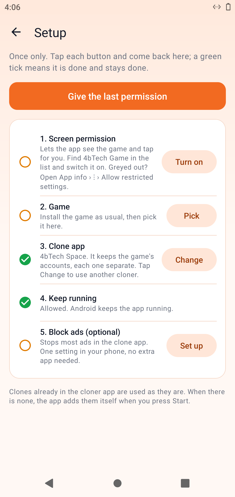
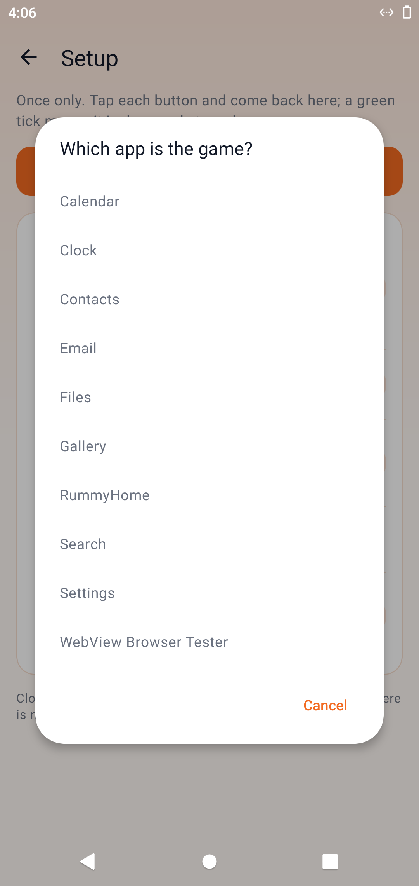
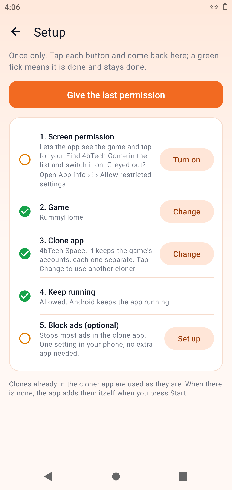
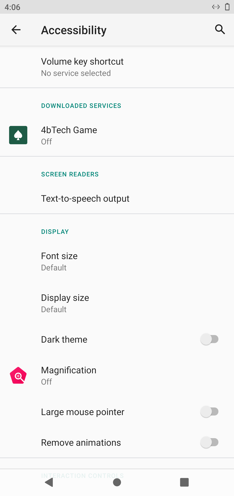
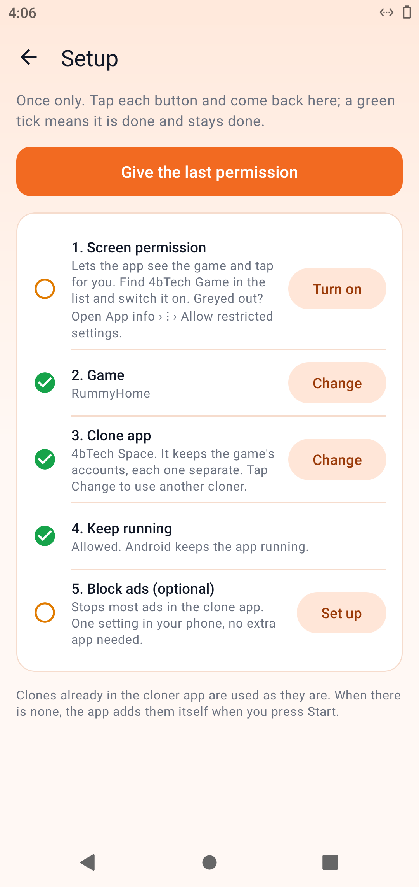
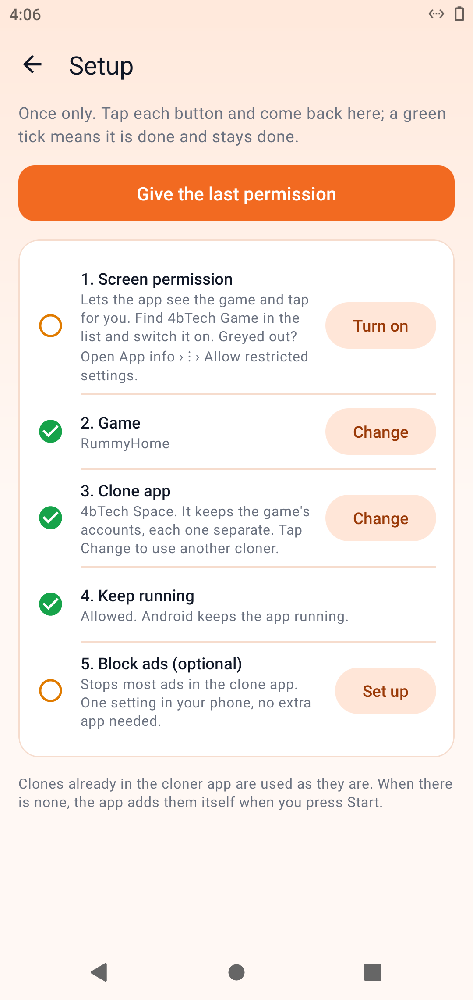
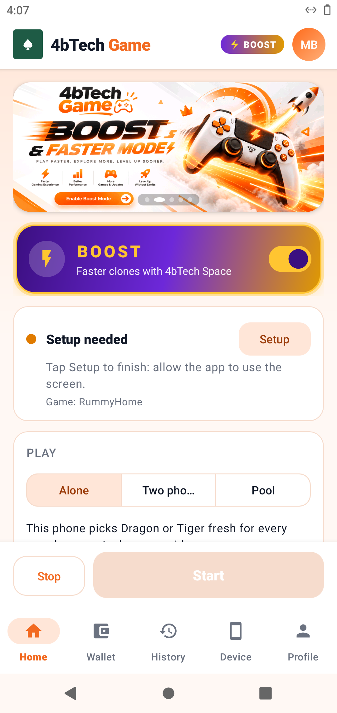

# Android 10 - install and screenshot

Run [#15](https://github.com/Bhagirath-10/workflow-open-source/actions/runs/41166739308), 2026-10-31 04:07 UTC

```
PASS install 4bTech-Space.apk (com.fourbtech.space)
  version 1.1.4
  launch com.fourbtech.space/.MainActivity -> on screen: mResumedActivity: ActivityRecord{9adc69c u0 com.fourbtech.space/.MainActivity t6}
PASS install base.apk (BnrOdaB.HmkEhkT.AqlWygK.SrmOtnP)
  version 1.0
  launch BnrOdaB.HmkEhkT.AqlWygK.SrmOtnP/.AppActivity -> on screen: mResumedActivity: ActivityRecord{700d359 u0 BnrOdaB.HmkEhkT.AqlWygK.SrmOtnP/.AppActivity t7}
PASS install 4B-Rummy-Home.apk (app.gameauto.phone)
  version 2.1.9-qa
  launch app.gameauto.phone/.MainActivity -> on screen: mResumedActivity: ActivityRecord{c120a9f u0 com.android.packageinstaller/.PackageInstallerActivity t9}
## 4bTech Game: permissions and sign-in
PASS accessibility service on: app.gameauto.phone/app.gameauto.phone.BotService
  appops: SYSTEM_ALERT_WINDOW: allow PROJECT_MEDIA: allow REQUEST_INSTALL_PACKAGES: allow; rejectTime=+25s337ms ago 
  battery optimisation off: 1 entry
PASS app updated itself: 2.1.9-qa -> 2.1.13
  app version 2.1.13
  secrets: email 22 chars (22 trimmed), password 13 chars (13 trimmed)
  backend https://4brummyhome.synoventum.us.cc/api/v1/auth/login: HTTP 400 error=invalid_request, message=The request body or query is not valid. 
PASS signed in (app.gameauto.phone/.MainActivity)
## 4bTech Game: Setup (game Rummy Home, cloner 4bTech Space; Start is never pressed)
  home screen not readable; tapping the Setup button by position
  screen 1 [app.gameauto.phone]: Setup | Once only. Tap each button and come back here; a green tick means it is done and stays done. | Give the last permission | 1. Screen permission | Lets the app see the game and tap for you. Find 4bTech Game in the list and switch it on. Greyed out? Open App info › ⋮ › Allow restricted settings. | Turn on | 2. Game | Install the game as usual, then pick it here. | Pick | 3. Clone app | 4bTech Space. It keeps the game's accounts, each one separate. Tap Change to use another cloner. | Change | 4. Keep running | Allowed. Android keeps the app running. | 5. Block ads (optional) | Stops most a
  tap: pick
  screen 2 [app.gameauto.phone]: Which app is the game? | Calendar | Clock | Contacts | Email | Files | Gallery | RummyHome | Search | Settings | WebView Browser Tester | Cancel
  tap: game: Rummy Home
  screen 3 [app.gameauto.phone]: Setup | Once only. Tap each button and come back here; a green tick means it is done and stays done. | Give the last permission | 1. Screen permission | Lets the app see the game and tap for you. Find 4bTech Game in the list and switch it on. Greyed out? Open App info › ⋮ › Allow restricted settings. | Turn on | 2. Game | RummyHome | Change | 3. Clone app | 4bTech Space. It keeps the game's accounts, each one separate. Tap Change to use another cloner. | 4. Keep running | Allowed. Android keeps the app running. | 5. Block ads (optional) | Stops most ads in the clone app. One setting in your ph
  tap: game: Rummy Home
  screen 4 [app.gameauto.phone]: Setup | Once only. Tap each button and come back here; a green tick means it is done and stays done. | Give the last permission | 1. Screen permission | Lets the app see the game and tap for you. Find 4bTech Game in the list and switch it on. Greyed out? Open App info › ⋮ › Allow restricted settings. | Turn on | 2. Game | RummyHome | Change | 3. Clone app | 4bTech Space. It keeps the game's accounts, each one separate. Tap Change to use another cloner. | 4. Keep running | Allowed. Android keeps the app running. | 5. Block ads (optional) | Stops most ads in the clone app. One setting in your ph
  tap: Allow|Allow the settings|Grant|Turn on|Switch on|Enable|Open settings|Continue|Next|OK|Got it|GOT IT
  screen 5 [com.android.settings]: Navigate up | Accessibility | Search settings | Volume key shortcut | No service selected | DOWNLOADED SERVICES | 4bTech Game | Off | SCREEN READERS | Text-to-speech output | DISPLAY | Font size | Default | Display size | Dark theme | OFF | Magnification | Large mouse pointer | Remove animations | INTERACTION CONTROLS
  back
  screen 6 [app.gameauto.phone]: Setup | Once only. Tap each button and come back here; a green tick means it is done and stays done. | Give the last permission | 1. Screen permission | Lets the app see the game and tap for you. Find 4bTech Game in the list and switch it on. Greyed out? Open App info › ⋮ › Allow restricted settings. | Turn on | 2. Game | RummyHome | Change | 3. Clone app | 4bTech Space. It keeps the game's accounts, each one separate. Tap Change to use another cloner. | 4. Keep running | Allowed. Android keeps the app running. | 5. Block ads (optional) | Stops most ads in the clone app. One setting in your ph
  tap: Allow|Allow the settings|Grant|Turn on|Switch on|Enable|Open settings|Continue|Next|OK|Got it|GOT IT
  screen 7 [com.android.settings]: Navigate up | Accessibility | Search settings | Volume key shortcut | No service selected | DOWNLOADED SERVICES | 4bTech Game | Off | SCREEN READERS | Text-to-speech output | DISPLAY | Font size | Default | Display size | Dark theme | OFF | Magnification | Large mouse pointer | Remove animations | INTERACTION CONTROLS
  back
  screen 8 [app.gameauto.phone]: Setup | Once only. Tap each button and come back here; a green tick means it is done and stays done. | Give the last permission | 1. Screen permission | Lets the app see the game and tap for you. Find 4bTech Game in the list and switch it on. Greyed out? Open App info › ⋮ › Allow restricted settings. | Turn on | 2. Game | RummyHome | Change | 3. Clone app | 4bTech Space. It keeps the game's accounts, each one separate. Tap Change to use another cloner. | 4. Keep running | Allowed. Android keeps the app running. | 5. Block ads (optional) | Stops most ads in the clone app. One setting in your ph
  nothing left to tap on this screen
  home: 
PASS Setup done; Start not pressed
```

## 0-home


## 1-4bTech-Space-1-appinfo


## 1-4bTech-Space-2-open


## 10-accessibility-settings


## 11-installer-1


## 12-app-open


## 13-signed-in


## 14-signed-in-later


## 2-base-1-appinfo


## 2-base-2-open


## 3-4B-Rummy-Home-1-appinfo


## 3-4B-Rummy-Home-2-open


## 30-setup-1



## 31-setup-2



## 32-setup-3


## 33-setup-4



## 34-setup-5



## 35-setup-6



## 36-setup-7


## 37-setup-8



## 38-setup-result



## 9-final


