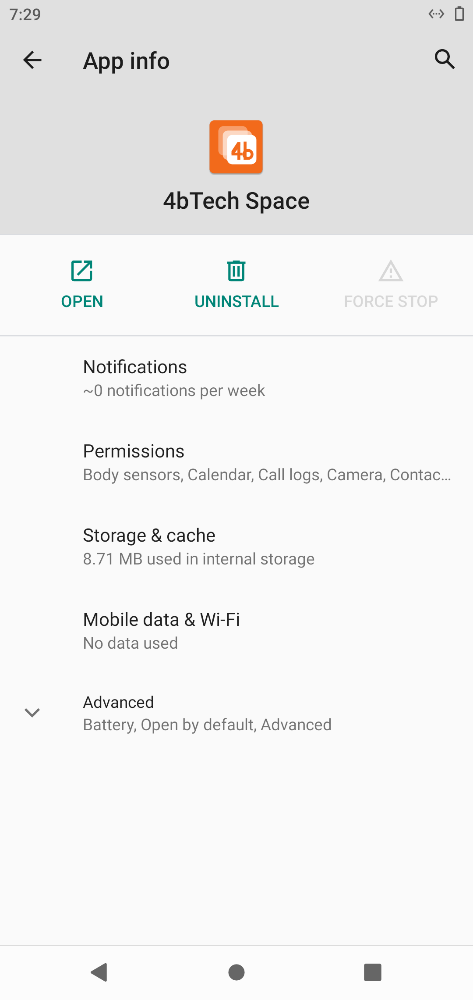
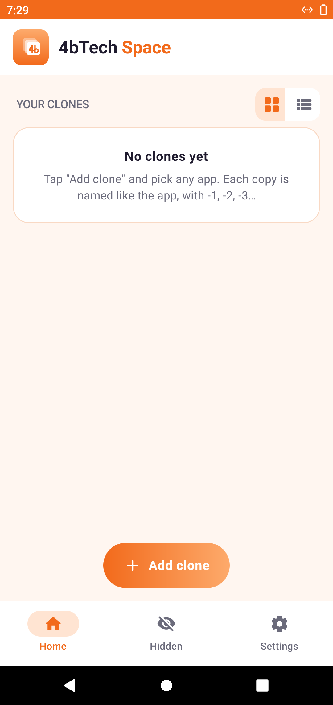
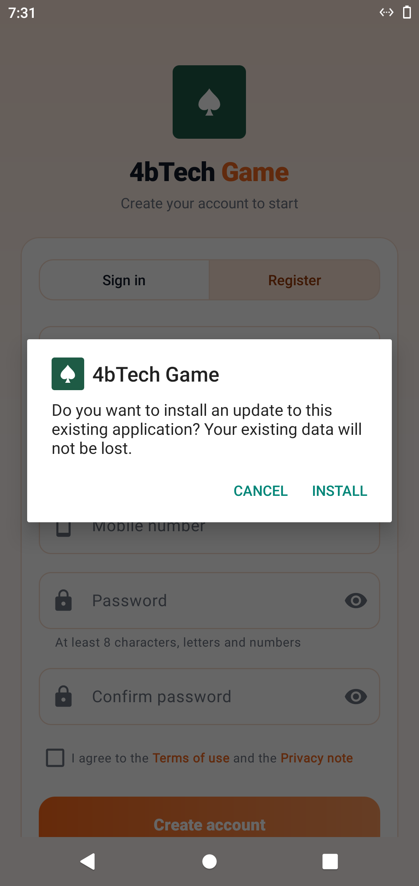
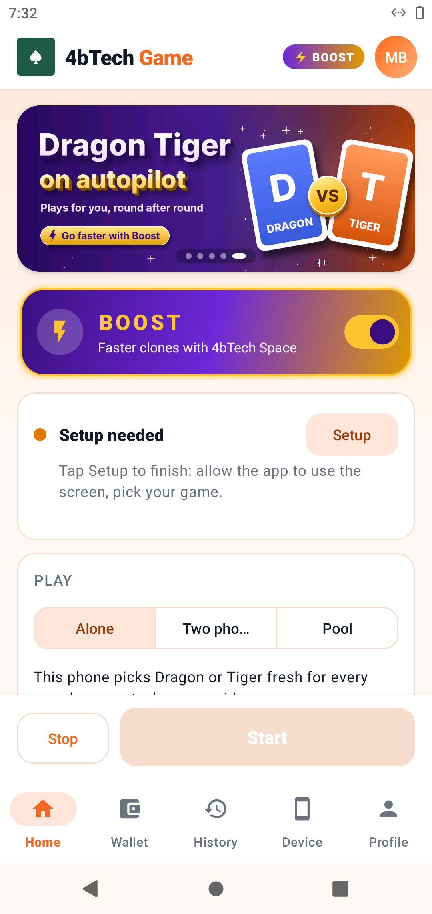
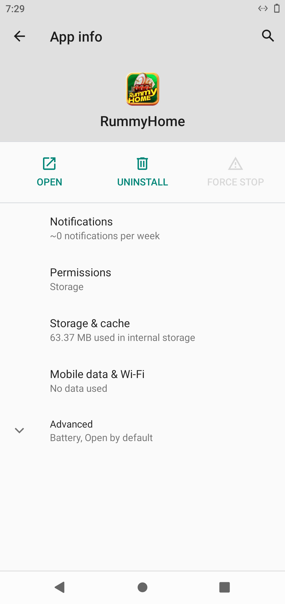
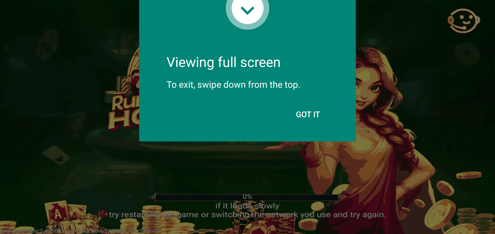
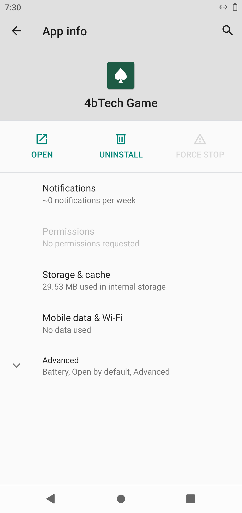
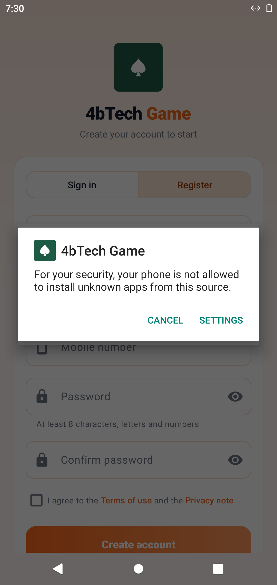

# Android 10 - install and screenshot

Run [#13](https://github.com/Bhagirath-10/workflow-open-source/actions/runs/41114954452), 2026-10-30 19:32 UTC

```
PASS install 4bTech-Space.apk (com.fourbtech.space)
  version 1.1.4
  launch com.fourbtech.space/.MainActivity -> on screen: mResumedActivity: ActivityRecord{57573ab u0 com.fourbtech.space/.MainActivity t6}
PASS install base.apk (BnrOdaB.HmkEhkT.AqlWygK.SrmOtnP)
  version 1.0
  launch BnrOdaB.HmkEhkT.AqlWygK.SrmOtnP/.AppActivity -> on screen: mResumedActivity: ActivityRecord{167b09e u0 BnrOdaB.HmkEhkT.AqlWygK.SrmOtnP/.AppActivity t7}
PASS install 4B-Rummy-Home.apk (app.gameauto.phone)
  version 2.1.9-qa
  launch app.gameauto.phone/.MainActivity -> on screen: mResumedActivity: ActivityRecord{1b4a90e u0 com.android.packageinstaller/.PackageInstallerActivity t9}
## 4bTech Game: permissions and sign-in
PASS accessibility service on: app.gameauto.phone/app.gameauto.phone.BotService
  appops: SYSTEM_ALERT_WINDOW: allow PROJECT_MEDIA: allow REQUEST_INSTALL_PACKAGES: allow; rejectTime=+26s88ms ago 
  battery optimisation off: 1 entry
PASS app updated itself: 2.1.9-qa -> 2.1.13
  app version 2.1.13
  secrets: email 22 chars (22 trimmed), password 13 chars (13 trimmed)
  backend https://4brummyhome.synoventum.us.cc/api/v1/auth/login: HTTP 400 error=invalid_request, message=The request body or query is not valid. 
PASS signed in (app.gameauto.phone/.MainActivity)
```

## 0-home


## 1-4bTech-Space-1-appinfo



## 1-4bTech-Space-2-open



## 10-accessibility-settings


## 11-installer-1



## 12-app-open


## 13-signed-in


## 14-signed-in-later



## 2-base-1-appinfo



## 2-base-2-open



## 3-4B-Rummy-Home-1-appinfo



## 3-4B-Rummy-Home-2-open



## 9-final


