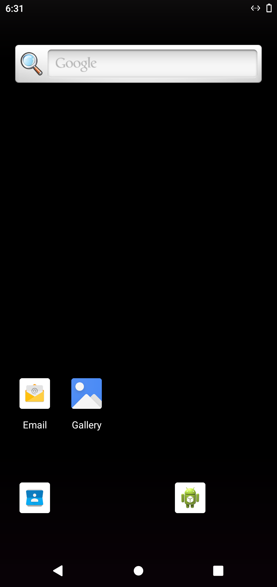

# Android 10 - install and screenshot

Run [#3](https://github.com/Bhagirath-10/workflow-open-source/actions/runs/41107396297), 2026-10-30 18:31 UTC

```
PASS install 4bTech-Space.apk (com.fourbtech.space)
PASS install base.apk (BnrOdaB.HmkEhkT.AqlWygK.SrmOtnP)
PASS install 4B-Rummy-Home.apk (app.gameauto.phone)
```

## 0-home


## 1-4bTech-Space


## 2-base


## 3-4B-Rummy-Home



## 9-final


