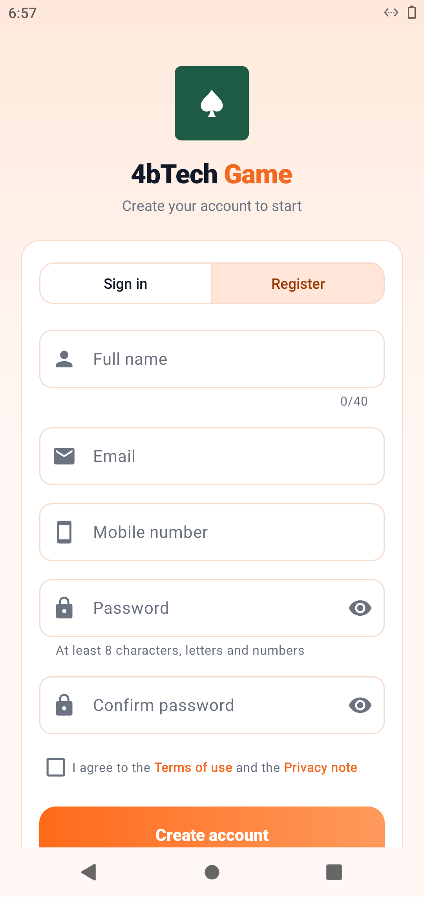
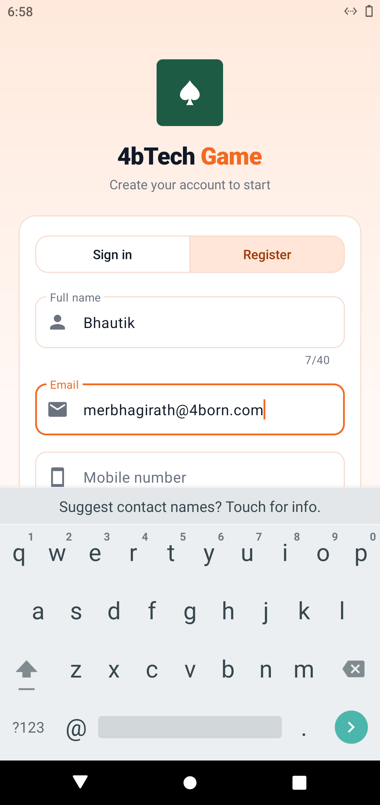

# Android 10 - install and screenshot

Run [#7](https://github.com/Bhagirath-10/workflow-open-source/actions/runs/41110833671), 2026-10-30 18:58 UTC

```
PASS install 4bTech-Space.apk (com.fourbtech.space)
  version 1.1.4
  launch com.fourbtech.space/.MainActivity -> on screen: mResumedActivity: ActivityRecord{89131ea u0 com.fourbtech.space/.MainActivity t6}
PASS install base.apk (BnrOdaB.HmkEhkT.AqlWygK.SrmOtnP)
  version 1.0
  launch BnrOdaB.HmkEhkT.AqlWygK.SrmOtnP/.AppActivity -> on screen: mResumedActivity: ActivityRecord{2c18c90 u0 BnrOdaB.HmkEhkT.AqlWygK.SrmOtnP/.AppActivity t7}
PASS install 4B-Rummy-Home.apk (app.gameauto.phone)
  version 2.1.9-qa
  launch app.gameauto.phone/.MainActivity -> on screen: mResumedActivity: ActivityRecord{8f606ae u0 com.android.packageinstaller/.PackageInstallerActivity t9}
## 4bTech Game: permissions and sign-in
PASS accessibility service on: app.gameauto.phone/app.gameauto.phone.BotService
  appops: SYSTEM_ALERT_WINDOW: allow PROJECT_MEDIA: allow REQUEST_INSTALL_PACKAGES: allow; rejectTime=+25s494ms ago 
  battery optimisation off: 1 entry
PASS app updated itself: 2.1.9-qa -> 2.1.13
  app version 2.1.13
  no field password
  no field confirm
PASS registered and signed in (app.gameauto.phone/.AuthActivity)
```

## 0-home


## 1-4bTech-Space-1-appinfo


## 1-4bTech-Space-2-open


## 10-accessibility-settings


## 11-installer-1


## 12-app-open


## 13-register-form



## 14-signed-in



## 15-signed-in-later


## 2-base-1-appinfo


## 2-base-2-open


## 3-4B-Rummy-Home-1-appinfo


## 3-4B-Rummy-Home-2-open


## 9-final


